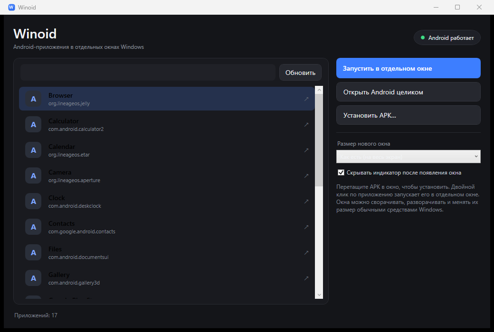

# Winndroid

Android-приложения и игры в отдельных окнах Windows. Внутри — WSL2, Waydroid
(LineageOS) и менеджер на PowerShell 7 + WPF.

**[Скачать установщик](https://github.com/Sergey35853/winndroid/releases/latest)**
· [Исходники и portable-zip](https://github.com/Sergey35853/winndroid/releases)

> **Статус: альфа.** Проект личный, публикуется для энтузиастов. Бэкенд
> (WSL-ядро с binder, Waydroid, GApps, libndk) пока ставится вручную по
> инструкции ниже; установщик ставит только менеджер и ADB. Автоматическая
> установка бэкенда — следующий шаг.



## Что умеет

- Показывает список запускаемых Android-приложений и ищет по имени/пакету.
- Открывает каждое приложение в отдельном окне Windows.
- Живой кадр через `PrintWindow`, изменение размера, сворачивание и
  восстановление, равномерное масштабирование с чёрными полями.
- Мышь, перетаскивание, колесо и физическая клавиатура уходят в Android.
- Устанавливает APK кнопкой или перетаскиванием файла в окно менеджера.
- Открывает полный интерфейс Android одной кнопкой.
- Показывает индикатор запуска, пока приложение не отрисует первый кадр.
  Если кадра нет 45 секунд, индикатор остаётся и объясняет причину.
- Проверяет, установлен ли Waydroid, и показывает кнопку с инструкцией,
  если бэкенд ещё не настроен.
- Несколько окон одновременно; закрытие окна закрывает приложение, закрытие
  менеджера возвращает исходные окна на экран.

## Требования

- Windows 11 22H2 или новее (нужна mirrored-сеть WSL, чтобы Windows-ADB видел
  Android по адресу контейнера). На Windows 10 не проверялось.
- WSL2 с включённым systemd.
- Ядро WSL с binder. Проект использует `linux-msft-wsl-6.18.58.1`.
- Waydroid 1.6.x, инициализированный с GApps, если нужен Play Store.
- `persist.waydroid.multi_windows = true`.
- libndk, если нужны ARM-приложения и игры.
- PowerShell 7.
- Android platform-tools (`adb.exe`).

GApps, Play Store и libndk **не входят** в поставку: их нужно установить
самостоятельно. Это осознанное ограничение по лицензиям.

## Быстрый старт

Если бэкенд уже настроен (Waydroid стоит в WSL, сессия запускается):

1. Проверьте сессию:

   ```bash
   waydroid status
   # Session: RUNNING
   ```

   Если сессия не запущена:

   ```bash
   systemctl --user start waydroid-session.service
   ```

2. Подключите ADB и проверьте устройство:

   ```powershell
   adb connect 192.168.240.112:5555
   adb devices
   ```

3. Запустите `Winndroid.cmd` (или `pwsh -File Winndroid.ps1` из исходников).

4. Выберите приложение и нажмите «Запустить в отдельном окне». Двойной клик
   по строке делает то же самое.

## Настройка

Менеджер читает необязательный файл
`%LOCALAPPDATA%\Winndroid\config.json`:

```json
{
  "wslDistro": "",
  "adbSerial": "192.168.240.112:5555"
}
```

- `wslDistro` — имя дистрибутива WSL (`wsl -l -q`). Пусто — дистрибутив по
  умолчанию.
- `adbSerial` — адрес Android для ADB. По умолчанию Waydroid использует
  `192.168.240.112:5555`.

Переменные окружения `WINNDROID_WSL_DISTRO` и `WINNDROID_ADB_SERIAL` имеют
приоритет над файлом.

ADB ищется по порядку:

1. `platform-tools\adb.exe` рядом с `Winndroid.ps1`;
2. `%LOCALAPPDATA%\Winndroid\platform-tools\adb.exe`;
3. `adb.exe` в `PATH`;
4. `%LOCALAPPDATA%\Android\Sdk\platform-tools\adb.exe`;
5. `C:\platform-tools\adb.exe`.

## Как поднять бэкенд

Ниже — ориентир, а не готовый установщик. Команды выполняются в WSL.

1. Установите WSL2 и Ubuntu 24.04, включите systemd в `/etc/wsl.conf`:

   ```ini
   [boot]
   systemd=true
   ```

2. Соберите ядро WSL с binder (или возьмите готовое из релизов проекта) и
   укажите его в `%UserProfile%\.wslconfig`:

   ```ini
   [wsl2]
   kernel=C:\\path\\to\\bzImage
   networkingMode=mirrored
   ```

   `wsl --shutdown` после изменения. Ядро общее для всех дистрибутивов WSL.

3. Установите Waydroid:

   ```bash
   sudo apt install -y curl ca-certificates
   curl -s https://repo.waydro.id | sudo bash
   sudo apt install -y waydroid
   sudo waydroid init -s GAPPS -f
   ```

4. Включите нужные свойства:

   ```bash
   sudo waydroid prop set persist.waydroid.multi_windows true
   sudo waydroid prop set persist.waydroid.no_background_subsurface true
   ```

5. Запустите контейнер и сессию от своего пользователя:

   ```bash
   sudo systemctl start waydroid-container
   waydroid session start
   ```

   Для автозапуска можно оформить пользовательский сервис
   `~/.config/systemd/user/waydroid-session.service` и включить linger:

   ```bash
   loginctl enable-linger "$USER"
   systemctl --user enable --now waydroid-session.service
   ```

6. Установите libndk, если нужны ARM-приложения. Удобный способ —
   [waydroid_script](https://github.com/casualsnek/waydroid_script):

   ```bash
   git clone https://github.com/casualsnek/waydroid_script
   cd waydroid_script
   sudo python3 -m venv venv
   sudo venv/bin/pip install -r requirements.txt
   sudo venv/bin/python3 main.py install libndk
   ```

7. Подключите ADB с Windows:

   ```powershell
   adb connect 192.168.240.112:5555
   ```

   Если адрес недоступен, проверьте `ip -4 addr show waydroid0` в WSL и
   `networkingMode=mirrored` в `.wslconfig`.

## Ограничения

- **Play Integrity, банковские приложения, DRM/Widevine и античиты** не
  работают или работают частично. Это ограничение Waydroid, а не менеджера.
- **Тяжёлые Unity-игры** могут не отрисовать кадр. В частности, Infinite
  Magicraid даёт чёрный экран и внутри самого Android (`adb exec-out screencap`
  тоже чёрный): это не баг окна, а связка приложения с программным
  Vulkan/SwiftShader и сетью. Окно остаётся с индикатором и объяснением.
- **GApps и Google-аккаунт.** Использование GApps может нарушать условия
  Google; ответственность на пользователе. Play Store может считать устройство
  непроверенным — ID регистрируется на
  <https://www.google.com/android/uncertified/>.
- **Ядро WSL общее.** Установка бэкенда меняет `.wslconfig` и ядро для всех
  дистрибутивов. Перед изменениями сделайте резервную копию.
- **Windows 10** не поддерживает mirrored-сеть WSL; прямая адресация Android
  может не работать.
- Установщик пока не подписан, SmartScreen может показать предупреждение.

## Разработка

```powershell
# запуск из исходников
pwsh -NoProfile -ExecutionPolicy Bypass -File .\Winndroid.ps1

# автозапуск приложения для проверки
pwsh -NoProfile -ExecutionPolicy Bypass -File .\Winndroid.ps1 -Launch org.telegram.messenger

# установка APK без диалога
pwsh -NoProfile -ExecutionPolicy Bypass -File .\Winndroid.ps1 -Install C:\path\app.apk
```

Основные части `Winndroid.ps1`:

- `NativeWin` — Win32: поиск окон, `PrintWindow`, стили, фокус.
- `FrameGrabber` — DIB-секция и захват кадра без копирования 14 МБ на кадр.
- `AdbShell` — постоянная `adb shell`-сессия, ввод с задержкой ~15 мс на
  команду.
- `New-AppWrapper` — окно приложения, масштабирование, ввод, индикатор.
- таймеры — кадры (40 мс), загрузка, установка, сессия, ADB health check.

## Сборка установщика

```powershell
winget install JRSoftware.InnoSetup
& "${env:ProgramFiles(x86)}\Inno Setup 6\ISCC.exe" installer\Winndroid.iss
```

Готовый файл появится в `dist\Winndroid-Setup-<версия>.exe`. GitHub Actions
собирает установщик и portable-zip по тегу `v*` и прикрепляет их к релизу.

## Лицензии и благодарности

Код менеджера — MIT (см. `LICENSE`). Waydroid, LineageOS, Android и
GApps распространяются по своим лицензиям и не входят в этот репозиторий.
Проект не связан с Google, Microsoft или Waydroid.
